

  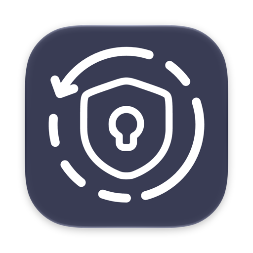

<h1 align="center">Authmeister</h1>

  Two-factor codes and passwords on your phone, watch and Mac. 
  Sync goes through your own cloud, encrypted with your backup password. There is no Authmeister server.

  English · <a href="README.ru.md">Русский</a>

  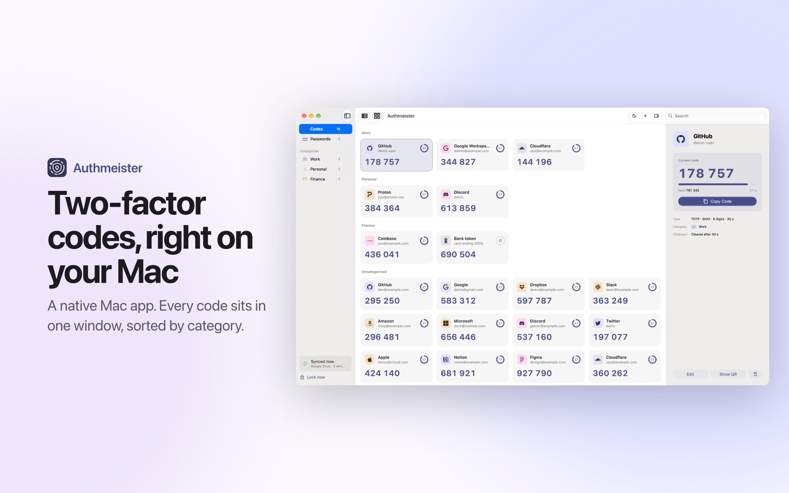

## Download

| Platform | Where |
|---|---|
| iPhone, iPad, Apple Watch | [App Store](https://apps.apple.com/app/id6742833866) |
| Android, Wear OS | [Google Play](https://play.google.com/store/apps/details?id=com.kopylovis.authmeister) or [RuStore](https://www.rustore.ru/catalog/app/com.kopylovis.authmeister) |
| Android without a store | `Authmeister-<version>.apk` from [Releases](https://github.com/Authmeister/authmeister/releases/latest) |
| Mac (macOS 26, Apple silicon) | `Authmeister-<version>-mac.zip` from [Releases](https://github.com/Authmeister/authmeister/releases/latest) |

This repository holds the downloadable builds and the issue tracker. The source code is not public.

## What it does

- TOTP and HOTP codes for every site with two-factor sign-in, sorted into categories
- Passwords next to their codes, with checks for leaked, weak and reused ones
- Sync between iPhone, iPad, Android and Mac through iCloud Drive, Google Drive, Dropbox or OneDrive
- Encrypted backups, and moving over from Google Authenticator with its export QR code
- Apple Watch and Wear OS apps, home screen widgets, a Mac menu bar and Quick Access on Option-Command-A
- Eleven languages

## Screenshots

### Mac

  
  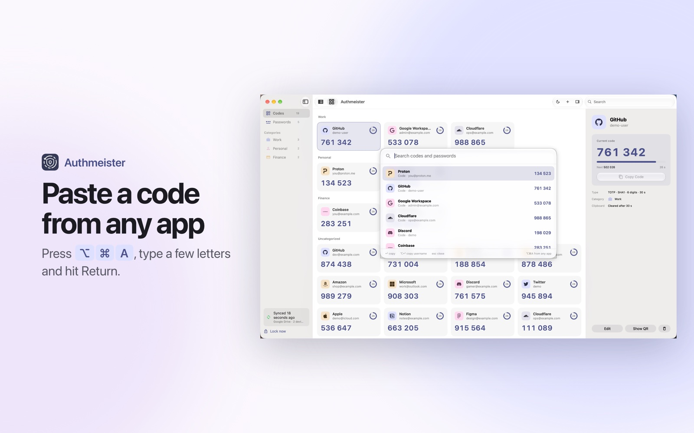

### iPhone and Android

  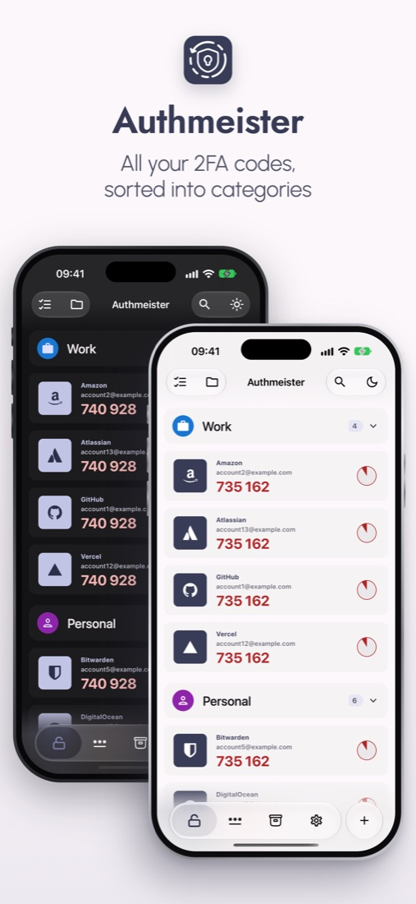
  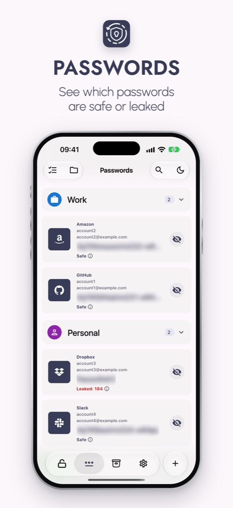
  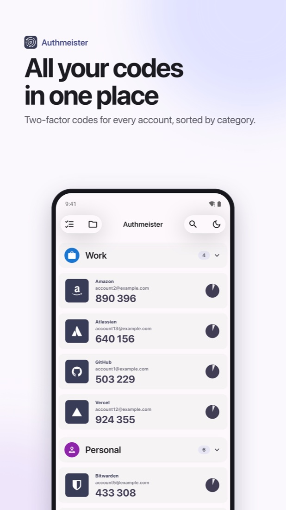
  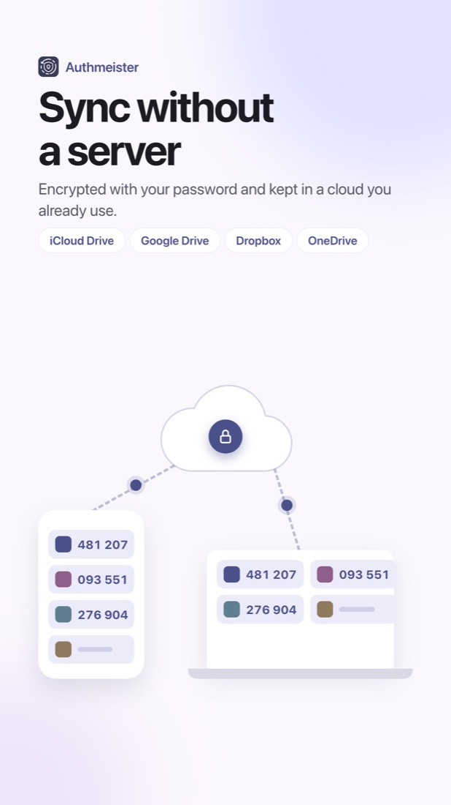

### iPad and Android tablets

  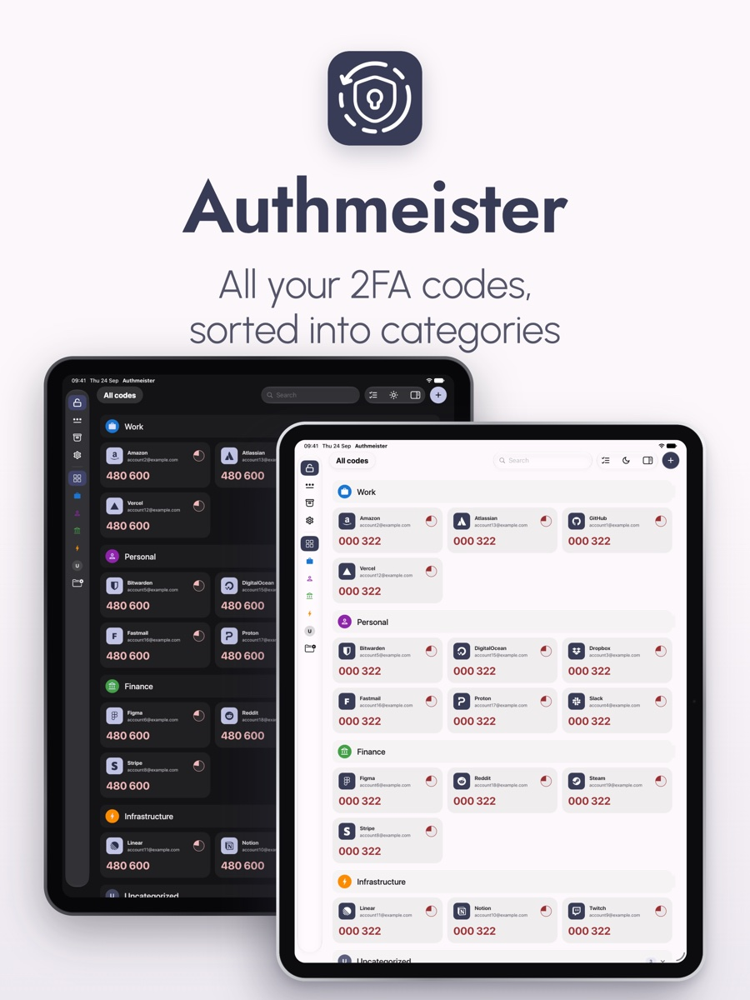
  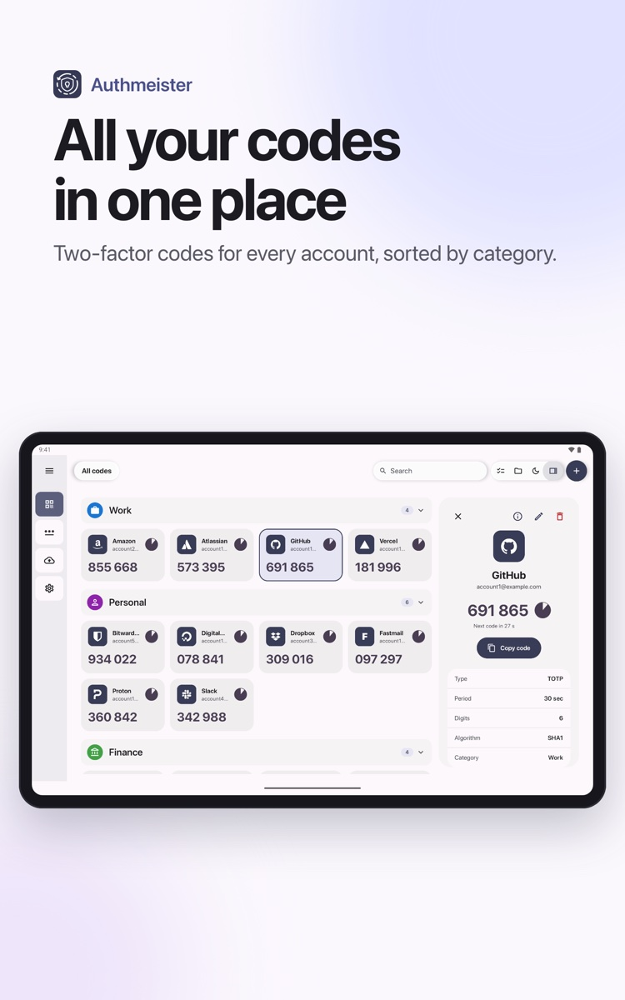

### Apple Watch

  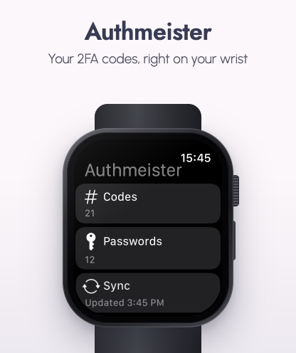
  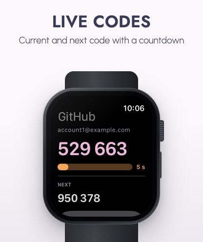

## Installing from Releases

Each release lists SHA-256 checksums in `SHA256SUMS.txt`. Check a file with `shasum -a 256 <file>`.

The Android APK is signed with a different key than the Google Play build, so Android will not install one over the other. Pick one source and update from it. To switch, make a backup, uninstall, install from the other source and restore. Obtainium and similar apps can watch this repository and update the APK for you.

On a Mac, unzip and move Authmeister to Applications. The app is signed with a Developer ID and notarized by Apple. To let Quick Access paste a code into the field you are typing in, allow Authmeister in System Settings › Privacy & Security › Accessibility. Without it, Return only copies the code. The Mac app does not update itself yet, so watch this repository (Watch › Custom › Releases) to hear about new versions.

## Support

Authmeister is free, and every feature works without paying. If the app has been useful, you can leave a tip on [Boosty](https://boosty.to/monoroh/donate). Tips are voluntary and unlock nothing.

## Feedback

Found a bug or missing something? Open an [issue](https://github.com/Authmeister/authmeister/issues).
