

  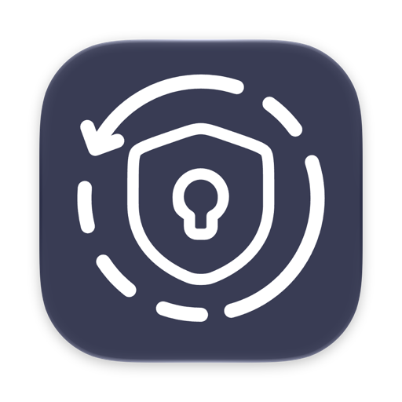

<h1 align="center">Authmeister</h1>

  Коды двухфакторной аутентификации и пароли на телефоне, часах и Mac. 
  Синхронизация идет через ваше облако и шифруется паролем бэкапа. Своего сервера у Authmeister нет.

  <a href="README.md">English</a> · Русский

  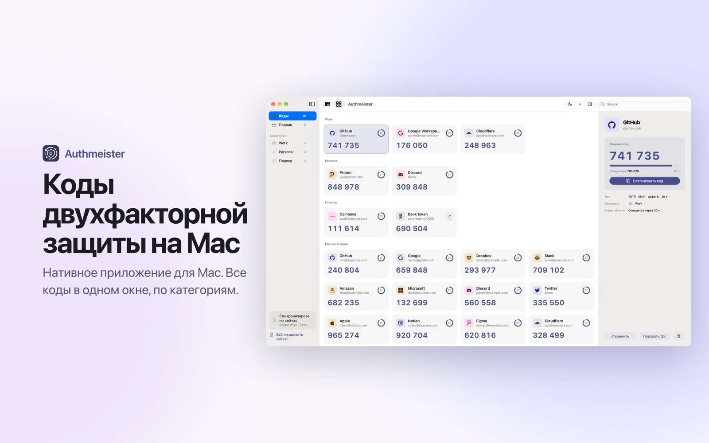

## Где скачать

| Платформа | Где |
|---|---|
| iPhone, iPad, Apple Watch | [App Store](https://apps.apple.com/app/id6742833866) |
| Android, Wear OS | [Google Play](https://play.google.com/store/apps/details?id=com.kopylovis.authmeister) или [RuStore](https://www.rustore.ru/catalog/app/com.kopylovis.authmeister) |
| Android без магазина | `Authmeister-<версия>.apk` в [Releases](https://github.com/Authmeister/authmeister/releases/latest) |
| Mac (macOS 26, Apple silicon) | `Authmeister-<версия>-mac.zip` в [Releases](https://github.com/Authmeister/authmeister/releases/latest) |

Здесь лежат сборки для скачивания и трекер ошибок. Исходный код закрыт.

## Что умеет

- Коды TOTP и HOTP для любого сайта с двухфакторным входом, разложенные по категориям
- Пароли рядом с кодами и проверка на утечки, слабые и повторяющиеся пароли
- Синхронизация между iPhone, iPad, Android и Mac через iCloud Drive, Google Drive, Dropbox или OneDrive
- Зашифрованные бэкапы и переезд из Google Authenticator по его QR-коду экспорта
- Приложения для Apple Watch и Wear OS, виджеты, коды в строке меню Mac и Quick Access по Option-Command-A
- Одиннадцать языков

## Скриншоты

### Mac

  
  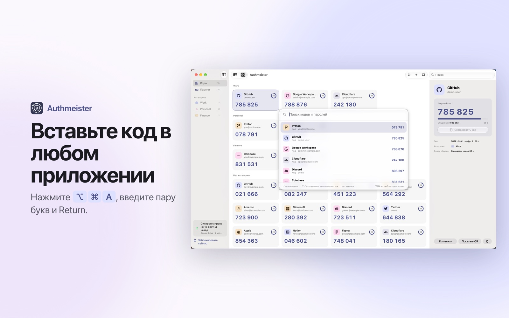

### iPhone и Android

  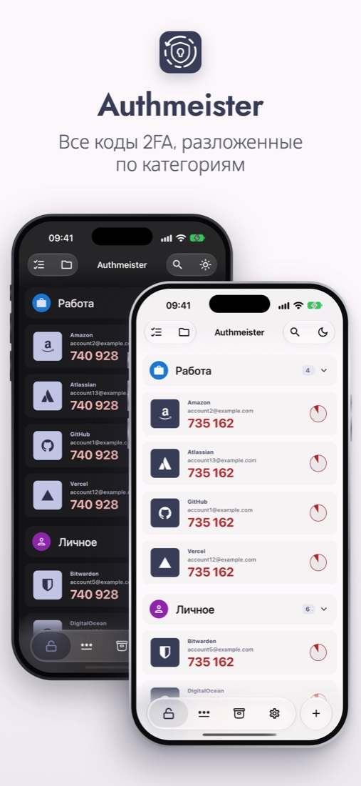
  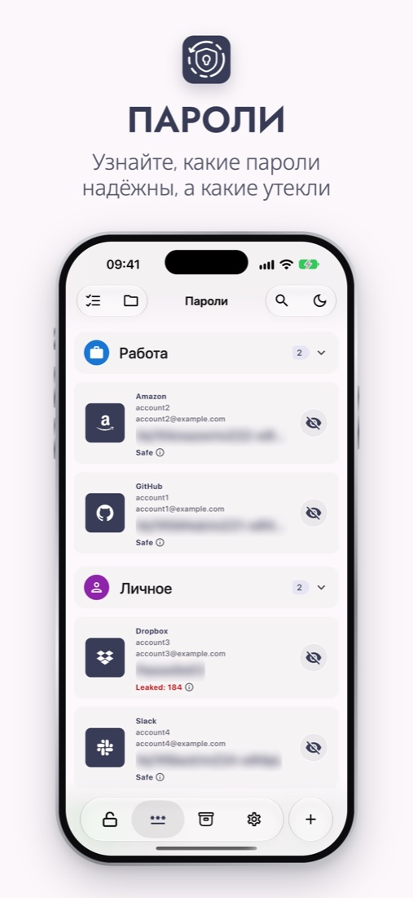
  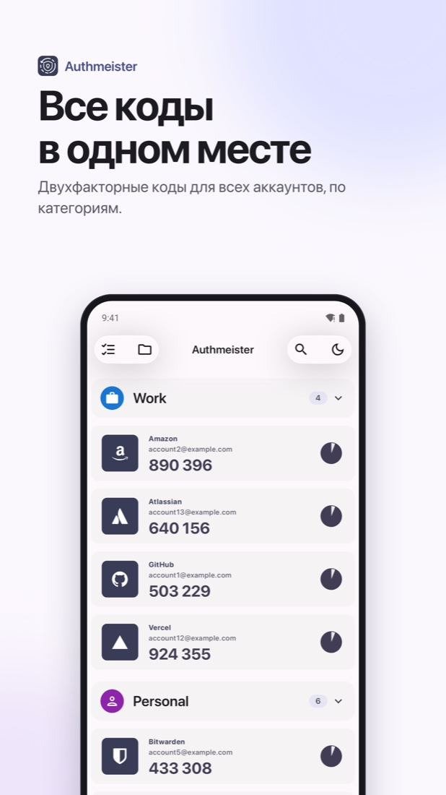
  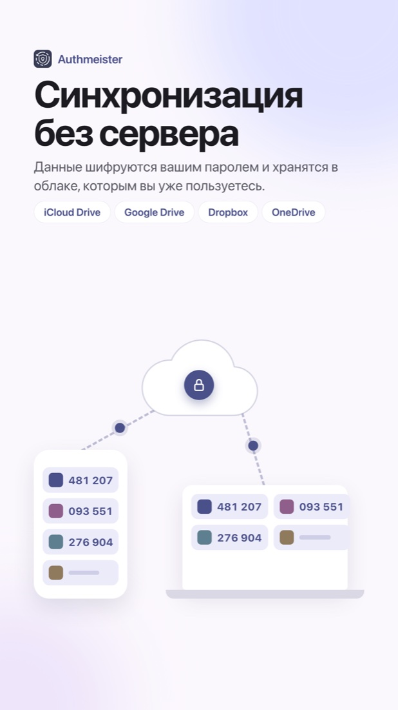

### iPad и планшеты на Android

  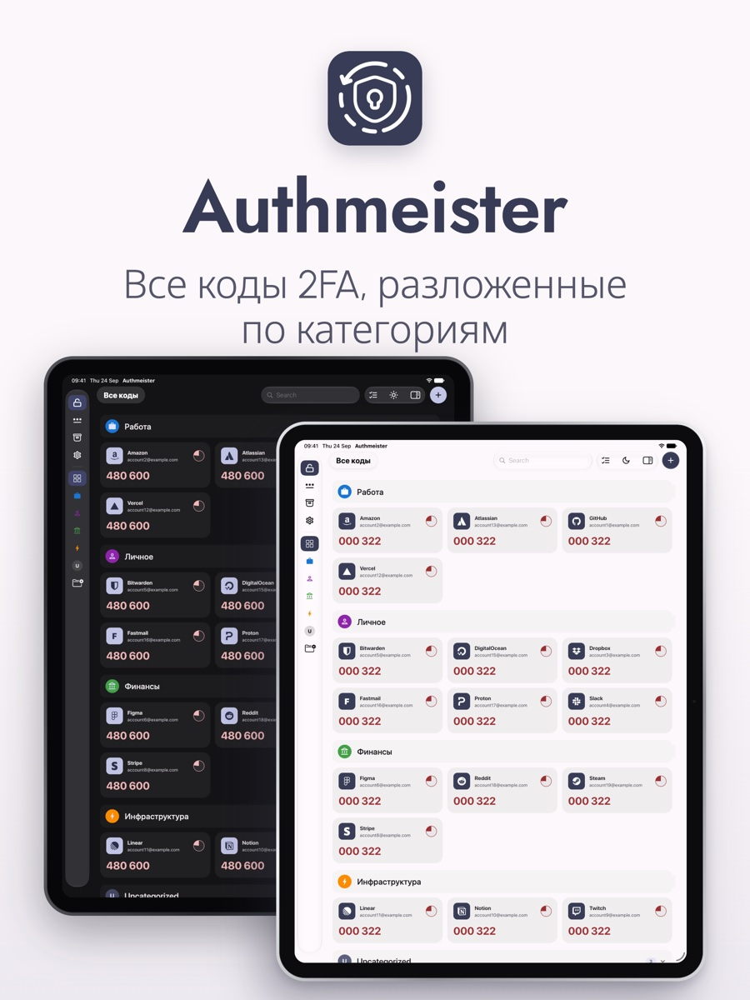
  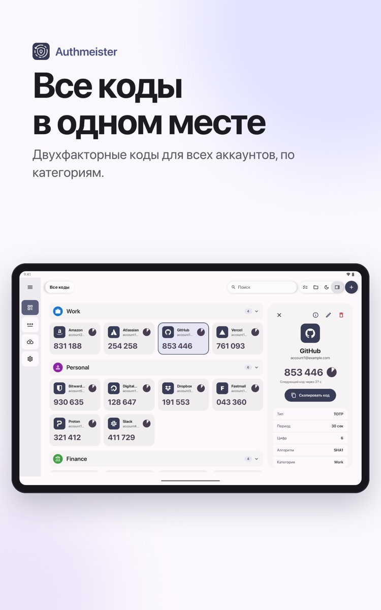

### Apple Watch

  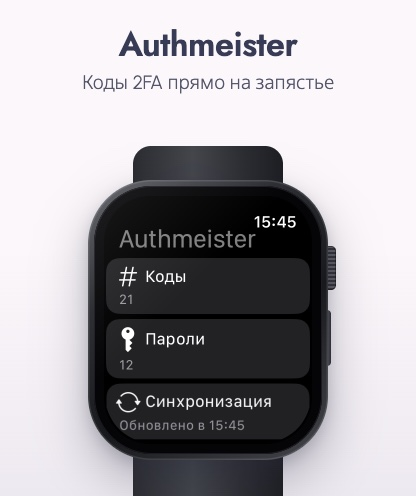
  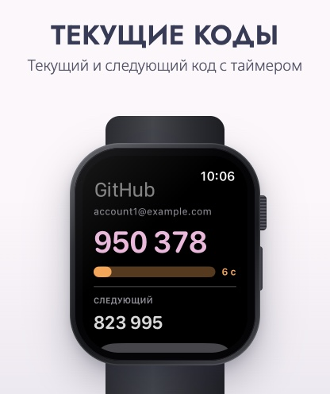

## Установка из Releases

К каждому релизу приложен `SHA256SUMS.txt` с контрольными суммами. Проверить файл можно командой `shasum -a 256 <файл>`.

APK для Android подписан другим ключом, чем сборка из Google Play, поэтому одна поверх другой не установится. Выберите один источник и обновляйтесь из него. Чтобы перейти на другой, сделайте бэкап, удалите приложение, поставьте его из нового источника и восстановите бэкап. Obtainium и похожие приложения умеют следить за этим репозиторием и обновлять APK сами.

На Mac распакуйте архив и перенесите Authmeister в "Программы". Приложение подписано Developer ID и нотаризовано Apple. Чтобы Quick Access вставлял код прямо в поле ввода, разрешите Authmeister в "Системные настройки › Конфиденциальность и безопасность › Универсальный доступ". Без этого Return только копирует код. Mac-версия пока не обновляется сама, поэтому подпишитесь на релизы этого репозитория (Watch › Custom › Releases), чтобы узнавать о новых версиях.

## Поддержать

Authmeister бесплатный, все функции работают без оплаты. Если приложение пригодилось, можно оставить чаевые на [Boosty](https://boosty.to/monoroh/donate). Это добровольно и ничего не открывает.

## Обратная связь

Нашли ошибку или чего-то не хватает? Откройте [issue](https://github.com/Authmeister/authmeister/issues).
